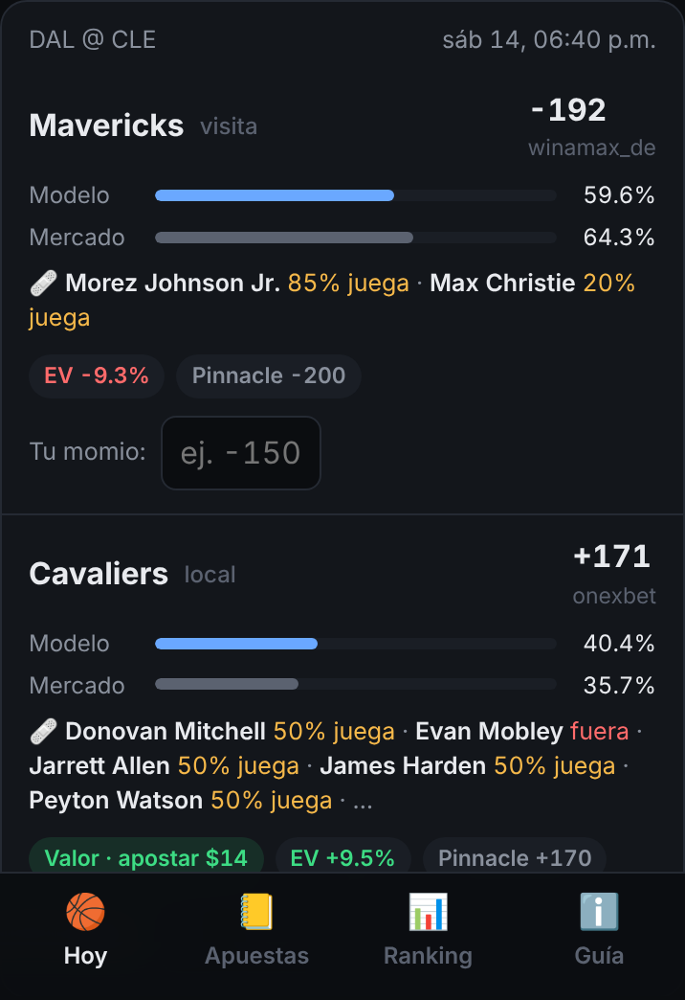

# 🏀 NBA · Modelo de probabilidades

> **EN:** An end-to-end NBA prediction model (moneyline, spreads and totals). It ingests official box scores, builds an Elo rating system, adds rest, form and injury features, and compares its probabilities against the betting market (Pinnacle's no-vig line) to find positive expected-value spots. Validation is strictly out-of-sample (trained on 2023-25, tested on 1,413 unseen games). Performance is tracked through Closing Line Value and paper trading, and everything is published as a mobile dashboard. Built in Python (pandas, scikit-learn) with a static front end on GitHub Pages, updated daily by a GitHub Actions workflow.

**Página en vivo:** [chrisvirrueta3.github.io/nba-modelo-probabilidades](https://chrisvirrueta3.github.io/nba-modelo-probabilidades)

Proyecto personal de ciencia de datos aplicada a mercados deportivos. La pregunta de fondo es económica: **¿se puede estimar la probabilidad de un partido mejor que un mercado de apuestas?** Si no, ¿qué tan cerca se queda un modelo construido solo con datos públicos?

<p align="center"></p>

---

## Resultados

Todo se mide en **datos de prueba que el modelo nunca vio**: se entrena con 2023-24 y 2024-25 y se evalúa en 2025-26 y en lo que va de 2026-27 (1,413 partidos).

<p align="center"></p>

| Modelo | Acierto | Brier | Log loss |
|---|---|---|---|
| Moneda al aire | — | 0.250 | 0.693 |
| Siempre gana el local | 55.1% | 0.248 | 0.688 |
| Elo | 68.9% | 0.204 | 0.595 |
| Elo + descanso + forma | 68.2% | 0.204 | 0.594 |
| **Modelo final (+ lesiones)** | **68.1%** | **0.201** | **0.587** |

**Hallazgos:**
- **El Elo hace casi todo el trabajo.** Descanso, back-to-backs y forma reciente casi no agregan nada por encima de él.
- **Las lesiones son la mejora más grande.** Agregar el valor de los jugadores que faltan bajó el log loss más que todas las demás variables juntas.
- **Un modelo más complejo no siempre es mejor.** Gradient Boosting salió *peor* que una regresión logística, porque con unos 2,000 partidos de entrenamiento se sobreajusta.
- **El acierto engaña.** El modelo final acierta un poco menos que el Elo, pero sus probabilidades son mejores. Para apostar importa la probabilidad, no el acierto.

### Spreads y totales

Para el hándicap y el over/under, el modelo proyecta **por cuántos puntos** gana cada equipo y **cuántos puntos** se anotan, y supone un error con distribución normal. Así calcula la probabilidad de cubrir cualquier línea.

| Mercado | Referencia | Modelo | Error típico (σ) | Dentro de ±1σ |
|---|---|---|---|---|
| Margen | Elo solo: 14.79 pts | **14.33 pts** | 14.0 | 68% |
| Total | Promedio de liga: 19.88 pts | **19.28 pts** | 18.9 | 68% |

- **La distribución normal funciona.** El 68% de los resultados cae dentro de ±1σ, exactamente lo que predice la teoría.
- **Para los totales, lo simple ganó.** Una fórmula directa (ritmo × eficiencia ofensiva y defensiva) superó a una regresión con más variables (19.3 contra 19.6 puntos de error), así que el proyecto usa la fórmula.
- **Las casas son más precisas en puntos.** Sus líneas suelen equivocarse unos 12 puntos en el margen. Por eso, en spreads y totales, el sistema exige más ventaja (EV ≥ 5%) y desconfía de cualquier proyección que se aleje más de 3 puntos (spread) o 5 puntos (total) de la línea de Pinnacle.

<p align="center">
  
  
</p>

---

## Metodología

### 1. Datos
- **Resultados y box scores** de cada partido y de cada jugador desde 2023-24, de la API oficial de la NBA (`nba_api`).
- **Momios** de más de 30 casas de apuestas ([The Odds API](https://the-odds-api.com)). Se guarda una "foto" diaria, incluida la línea de cierre.
- **Reporte de lesiones** diario de ESPN.
- Los partidos en sede neutral (Ciudad de México, Europa, NBA Cup) se marcan aparte para no darles ventaja de local.

### 2. Elo
Cada equipo tiene una calificación que se actualiza después de cada partido según el resultado, el margen y la localía (fórmula estilo FiveThirtyEight). Los parámetros (K, ventaja de local y reversión a la media entre temporadas) se ajustan **solo** con 2024-25 y se prueban en temporadas posteriores. La probabilidad de cada partido se calcula *antes* de actualizar con su resultado, así que no hay fuga de información.

### 3. Variables adicionales
| Variable | Idea |
|---|---|
| Net rating (temporada y últimos 10) | Puntos por cada 100 posesiones; se encoge hacia 0 al inicio de la temporada |
| Descanso, back-to-back, 3 juegos en 4 noches | Cansancio |
| **Bajas** | Suma del valor (Game Score promedio) de los jugadores de la rotación que no juegan |

Para partidos futuros, las bajas se calculan con el reporte de lesiones: cada baja se pondera por la probabilidad de que el jugador juegue (fuera = 0%, en duda = 50%…).

Para spreads y totales se agregan el **ritmo** (posesiones por partido) y la **eficiencia** (puntos anotados y recibidos por cada 100 posesiones) de cada equipo. Al inicio de la temporada se encogen hacia el promedio de la liga.

### 4. Del modelo a la decisión
1. **Probabilidad justa del mercado:** se toma el momio de Pinnacle y se le quita el margen de la casa.
2. **Valor esperado:** `EV = P(ganar) × (momio_decimal − 1) − P(perder)`, usando el mejor momio disponible. En spreads y totales se evalúa cada línea de cada casa (−5.5 en una, −6 en otra) y se elige la de mayor EV. Si la línea es un número entero, se considera el empate exacto (*push*), que devuelve la apuesta.
3. **Filtros:** solo se marca una apuesta con EV ≥ 3%. Si el modelo difiere del mercado por más de 10 puntos, se marca como *sospechosa* y no se apuesta, porque casi siempre significa que el mercado sabe algo que el modelo no.
4. **Monto:** Kelly fraccional (¼) con tope de 2% del bankroll.

### 5. Evaluación en vivo
- **Paper trading:** cada apuesta sugerida se registra y se liquida automáticamente.
- **CLV (Closing Line Value):** compara el momio tomado contra la probabilidad justa de cierre (en spreads y totales, en puntos de línea). Es la métrica más confiable de habilidad, porque el ROI necesita cientos de apuestas para dejar de ser ruido.
- **Modelo vs. mercado:** en *todos* los partidos predichos, no solo en los apostados. Para el ganador se usa el Brier score; para spreads y totales, el error en puntos frente a la línea de Pinnacle.

---

## Estructura

```
src/
  config.py              parámetros, rutas y equipos
  descargar_partidos.py  box scores por equipo (nba_api)
  limpiar_partidos.py    1 fila por partido + validaciones
  descargar_jugadores.py box scores por jugador
  bajas.py               valor de cada jugador y bajas históricas
  elo.py                 modelo Elo + búsqueda de parámetros + validación
  caracteristicas.py     variables sin fuga de información
  modelo.py              regresión logística vs. gradient boosting
  puntos.py              margen y total esperados + probabilidad de cubrir
  apm.py                 (experimento) +/− ajustado de cada jugador
  descargar_momios.py    snapshots de momios (The Odds API)
  lesiones.py            reporte de ESPN -> bajas esperadas
  valor.py               EV, Kelly y registro de apuestas simuladas
  liquidar.py            resultados, ROI, CLV y modelo vs. mercado
  exportar_web.py        genera web/datos.json
  graficas.py            gráficas de este README
web/                     página estática (HTML/CSS/JS, sin frameworks), publicada con GitHub Actions
.github/workflows/       publicación automática en GitHub Pages
rutina.bat               rutina diaria completa en un doble clic (Windows); sube los datos a GitHub
configurar_github.bat    conecta la carpeta con GitHub (una sola vez)
```

## Cómo correrlo

```bash
python -m venv .venv
.venv\Scripts\activate          # Windows  (Mac/Linux: source .venv/bin/activate)
pip install -r requirements.txt

# clave gratuita de https://the-odds-api.com
copy .env.example .env           # y pega tu clave en .env

python src/descargar_partidos.py && python src/limpiar_partidos.py
python src/descargar_jugadores.py && python src/bajas.py
python src/elo.py && python src/modelo.py && python src/puntos.py
python src/descargar_momios.py && python src/valor.py
```

Rutina diaria: `rutina.bat`, o los mismos comandos con `--actual`, y luego `liquidar.py` y `exportar_web.py`. Guía paso a paso en [docs/GUIA.md](docs/GUIA.md).

---

## Experimentos que no pasaron la prueba

Documentar lo que **no** funcionó también es parte del método.

**+/− ajustado (APM) como valor de los jugadores.** El Game Score casi no mide la defensa, así que probé un +/− ajustado: una regresión Ridge sobre el margen de cada partido, con los minutos de cada jugador, con el Game Score por 36 minutos como base y valores calculados solo con temporadas anteriores (`src/apm.py`).

| Variables de lesiones | Log loss | Error en margen |
|---|---|---|
| Game Score (actual) | 0.5865 | 14.33 |
| Solo APM | 0.5889 | 14.44 |
| Ambas | 0.5850 | 14.31 |

Combinado mejora un poco, pero un bootstrap de 5,000 muestras da un intervalo de confianza que incluye el cero (la mejora es positiva solo en el 72% de las muestras). No es suficiente evidencia para justificar la complejidad, así que el modelo sigue con Game Score. La escala del APM sí salió bien calibrada (−1.19 puntos de margen por punto de impacto, contra −1 teórico), y debería mejorar con más temporadas de datos: queda para volver a probar.

**Regresión para los totales.** Una regresión con ritmo, lesiones y cansancio salió peor (19.6 puntos de error) que la fórmula directa ritmo × eficiencia (19.3).

**Gradient Boosting para el ganador.** Peor que la regresión logística (log loss 0.597 contra 0.587): con unos 2,000 partidos de entrenamiento se sobreajusta.

## Limitaciones

- **Lesiones de último minuto:** en el histórico se sabe quién no jugó al final. En vivo, el reporte es incierto, así que el efecto real es menor que en el backtest.
- **Game Score** es una medida simple del valor de un jugador y no captura bien la defensa.
- **Sin momios históricos gratuitos:** la comparación contra el mercado se hace con los momios que el proyecto guarda desde noviembre de 2026.
- **Spreads y totales sin backtest contra el mercado:** el modelo de puntos se validó contra resultados reales, pero no contra líneas históricas. Si de verdad le gana a las casas, se sabrá con el CLV de las próximas semanas.

## Aviso

Proyecto educativo y de análisis de datos. **No es una recomendación de apuestas.** Los mercados de apuestas son muy eficientes y la mayoría de los modelos públicos no les gana a largo plazo. Las apuestas que aparecen aquí son simuladas.

---

Hecho por **Christopher Virrueta**, estudiante de Economía en la UMSNH (Morelia, México).
